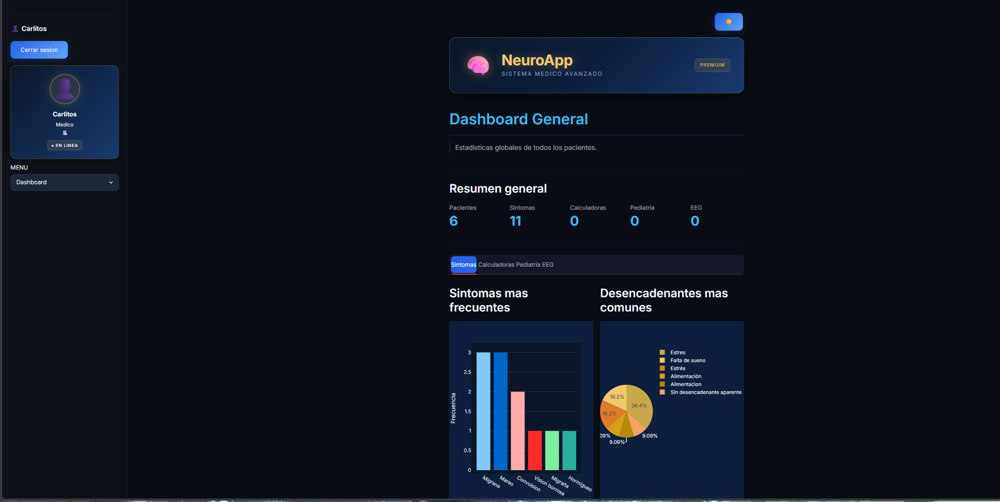

# neuro-assist

App web para registrar y reportar síntomas de epilepsia, migraña y Parkinson. Está hecha en Python con Streamlit e incluye un chat con IA.

> Es un proyecto para aprender. No sustituye la opinión de un médico.



## Cómo correrla

1. Clona el repo y entra a la carpeta:

```bash
git clone https://github.com/Kadowold/neuro-assist.git
cd neuro-assist
```

2. Instala las dependencias:

```bash
pip install -r requirements.txt
```


3. Arranca la app:

```bash
streamlit run app.py
```

Se abre sola en el navegador, normalmente en http://localhost:8501.

o bien simplemente entrar al link del release, aunque se tiene que cerrar y entrar un par de veces para que se logre entrar, aun sigo trabajando en eso.
